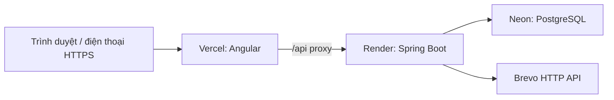

# Đề xuất deploy BKevent — 25/11/2026

Đề xuất cho demo nhóm: **Angular trên Vercel, Spring Boot Docker trên Render, PostgreSQL trên Neon, email qua Brevo HTTP**. Đã có `render.yaml` và `frontend/vercel.json` để cấu hình dịch vụ; chưa tạo môi trường cloud hoặc nghiệm thu HTTPS. Giữ backend phân tầng hiện tại.

Hệ thống vẫn theo ba tầng frontend/API/database; bên trong backend là layered monolith (Controller → Service → Repository). Việc đặt các tầng trên các dịch vụ khác nhau không biến backend thành microservices.



## Vì sao dùng proxy `/api`

Frontend hiện gọi `/api` với `credentials: same-origin`; cookie phiên HttpOnly có Path=/api, SameSite=Lax và CSRF cookie/token đi kèm. Cho trình duyệt gọi thẳng `onrender.com` từ `vercel.app` sẽ cần thiết kế lại cross-origin/cookie. External rewrite giữ URL ở domain frontend, phù hợp cơ chế đang có. Cần xác minh Set-Cookie, logout, CSRF và CSV qua proxy trên bản preview. [Vercel: external rewrites](https://vercel.com/docs/routing/rewrites).

Không chuyển token sang localStorage để xử lý lỗi deploy. Cookie bảo mật được bật ở backend; mọi API vẫn kiểm tra quyền như local.

## Các bước

Nếu build báo Maven Central `429 Too Many Requests`: Dockerfile dùng mirror Central trên Google Cloud Storage và retry tối đa 3 lần, giữ nguyên version dependency và các test. Sau khi cập nhật source, chọn Manual Deploy → Deploy latest commit trên Render. Hướng dẫn mirror: [Google Cloud](https://docs.cloud.google.com/docs/buildpacks/java#google_cloud_hosted_maven_central_mirror).

1. Chốt nhánh chứa I1/I2/I3, phần chi tiết điểm danh và sửa nội dung dài. Hoàn thành review/regression trước khi đưa candidate lên cloud.
2. Tạo project Neon PostgreSQL, chọn vùng gần backend. Database rỗng được Flyway tạo/nâng schema khi backend khởi động; không chạy baseline SQL thủ công trước. Database I3 cũ cần backup và bước nhận baseline một lần theo [OPERATIONS.md](OPERATIONS.md). 12 khoa đã đồng bộ riêng; nhập đơn vị tổ chức dùng thật, không bật dev-seed.
3. Tạo Render Blueprint từ `render.yaml`, chọn đúng nhánh candidate. Hoặc tạo Web Service Docker thủ công: **Root Directory `backend`**, Dockerfile `Dockerfile`, health check `/api/live`. Cấu hình đã có SERVER_ADDRESS=0.0.0.0 và đọc PORT. `/api/live` không đánh thức database; kiểm tra `/api/health` riêng sau triển khai. Blueprint dùng plan Free, tự deploy tắt; kiểm tra plan trên dashboard trước khi tạo. [Render: Blueprint](https://render.com/docs/blueprint-spec), [port](https://render.com/docs/web-services#port-binding).
4. Đặt secrets/environment dưới đây ở backend. Tạo Admin đầu tiên bằng bootstrap; sau khi kiểm tra đăng nhập, tắt bootstrap và gỡ mật khẩu bootstrap khỏi cấu hình. Giữ dev-seed tắt.
5. Tạo Vercel project: Root Directory `frontend`, Node 24. Proxy đã trỏ tới **https://bkevent-api.onrender.com**; không cần biến BACKEND_ORIGIN, rồi deploy. `frontend/vercel.json` đã khai báo install/build/output, proxy và SPA fallback. Chạy preview để kiểm tra đường dẫn trực tiếp.
6. Test qua HTTPS: Admin cấp Organizer → đổi mật khẩu → tạo/công bố → Student đăng ký → mail → quét QR/xác nhận → trang chi tiết → thủ công/lịch sử → báo cáo/CSV → logout và thử request trái quyền. Sau đó kiểm tra restart backend vẫn đọc phiên/QR bằng khóa ổn định, backup/restore và log lỗi.

## Environment backend

Giá trị dưới đây là tên/placeholder; không dùng mật khẩu thật trong Git:

```dotenv
SERVER_ADDRESS=0.0.0.0
TZ=Asia/Ho_Chi_Minh
DB_URL=jdbc:postgresql://<neon-direct-host>/<database>?sslmode=require&currentSchema=campus
DB_USER=<database-role>
DB_PASSWORD=<backend-secret>
AUTH_COOKIE_SECURE=true
ATTENDANCE_TOKEN_KEY=<base64-of-32-random-bytes>
CAMPUS_DEV_SEED_ENABLED=false
CAMPUS_BOOTSTRAP_ENABLED=true
CAMPUS_BOOTSTRAP_EMAIL=<first-admin-email>
CAMPUS_BOOTSTRAP_PASSWORD=<initial-admin-secret>
MAIL_ENABLED=false
BREVO_API_KEY=<backend-secret>
BREVO_SENDER_EMAIL=<verified-sender>
BREVO_SENDER_NAME=BKevent
```

Ban đầu MAIL_ENABLED=false để kiểm tra tài khoản/dữ liệu; xác minh sender và dữ liệu người nhận rồi mới bật. Bootstrap chỉ tạo Admin khi chưa có Admin hoạt động, không cấp lại mật khẩu cho tài khoản có sẵn. Khóa QR phải giữ ổn định qua restart/deploy. JDBC URL dùng thông số Neon Connect và SSL; ứng dụng hiện giữ user/password ở hai biến riêng. Khởi đầu dùng direct endpoint với Hikari pool nhỏ (hiện tối đa 5) để giảm các khác biệt về transaction/session pooling. [Neon: Java/JDBC](https://neon.com/docs/guides/java).

## Cấu hình Vercel đã có

`frontend/vercel.json` dùng cấu hình JSON tĩnh theo [Vercel configuration](https://vercel.com/docs/project-configuration/vercel-json). Proxy trỏ tới `https://bkevent-api.onrender.com/api/:path*`, có SPA fallback và no-store cho API. Không cần BACKEND_ORIGIN; biến cũ trên Vercel có thể xóa. Nếu đổi hostname backend, sửa destination của rewrite đầu tiên rồi commit/deploy lại. Không đặt secret trong URL này.

Kiểm tra API không bị trả index.html, assets không bị rewrite nhầm, deep link `/events/6`/`/scan`/`/reports` mở được và logout xóa cookie trên đúng frontend domain. Không cache riêng các response phiên/QR/báo cáo của người dùng. Đừng copy nguyên Nginx local sang cloud: upstream `backend:8080` chỉ tồn tại trong mạng Docker Compose.

Quy tắc regex trong rewrites dùng capture group theo [Vercel project configuration](https://vercel.com/docs/project-configuration/vercel-json). App này là CSR nên fallback dùng index.html; nếu sau này bật prerender/SSR phải đối chiếu lại output theo [Angular deployment](https://angular.dev/tools/cli/deployment).

## Chi phí và giới hạn

| Dịch vụ | Phương án demo và giới hạn cần biết |
| --- | --- |
| Vercel | Hobby miễn phí trong quota; quyền cộng tác/usage phụ thuộc gói. [Hobby](https://vercel.com/docs/plans/hobby) |
| Render | Có Free Web Service, ngủ sau 15 phút không có traffic; lần truy cập sau phải đợi khởi động. Không phù hợp yêu cầu luôn sẵn sàng. [Free instances](https://render.com/docs/free) |
| Neon | Free hiện có 100 CU-hours/project/tháng và 1 GB Postgres/project; compute tự nghỉ sau 5 phút. Theo dõi quota, không mặc định miễn phí vô hạn tài nguyên. [Neon plans](https://neon.com/docs/introduction/plans) |
| Brevo | Giữ HTTP API đã tích hợp. Render Free chặn các cổng SMTP thông dụng, nên không chuyển sang SMTP Gmail chỉ để deploy. [Render SMTP restriction](https://render.com/changelog/free-web-services-will-no-longer-allow-outbound-traffic-to-smtp-ports) |

Có thể bắt đầu với free tier trong giới hạn của từng dịch vụ. Nếu dùng thật hoặc demo cần phản hồi ổn định, ưu tiên backend Render trả phí không ngủ; chọn plan theo dashboard/bảng giá tại lúc triển khai. Không dùng Render Postgres Free thay Neon cho dữ liệu cần giữ lâu chỉ vì cùng nhà cung cấp: tài liệu Render hiện ghi database Free hết hạn sau 30 ngày.

Từ việc Render Free ngủ có thể suy ra scheduler gửi outbox trong process cũng dừng lúc ngủ; retry còn lưu trong PostgreSQL và tiếp tục khi backend chạy lại. Không cam kết mail nền hoặc thời gian phản hồi luôn tức thì trên phương án miễn phí.

Outbox đã giãn thăm dò khi rỗng tới 10 phút và đánh thức sau commit khi có mail mới trong cùng process. Render probe dùng `/api/live`, không query PostgreSQL. Retry/traffic và các probe khác vẫn có thể giữ database hoạt động; theo dõi dashboard trước khi chọn kế hoạch chạy thường trực. Đây là cải thiện tần suất truy vấn, chưa phải bằng chứng đo được quota hay mail nền đúng hạn. Chi tiết: [vận hành](OPERATIONS.md#rate-limit-và-email).

Chưa tạo tài khoản/project, chưa đẩy secrets lên dịch vụ, chưa phát sinh chi phí. Nếu dùng phương án này thay Lightsail, ghi rõ thay đổi trong báo cáo; không đánh dấu RA02/A11 Lightsail đã hoàn thành.
